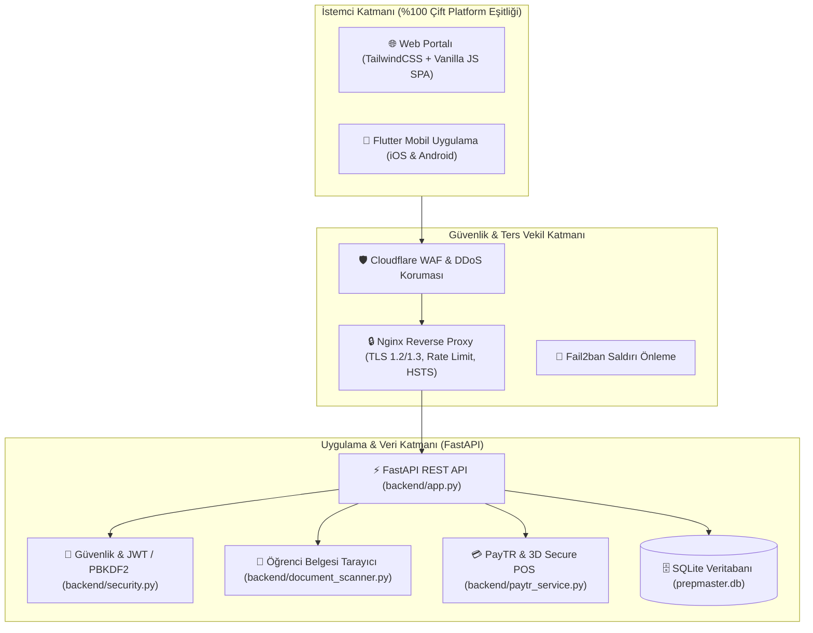

# 🎓 PrepMaster — Üniversite Hazırlık Muafiyet (Proficiency) Platformu Proje Özeti

**PrepMaster**, Türkiye'nin önde gelen üniversitelerinin İngilizce Hazırlık Muafiyet sınavlarına (**İTÜ, Boğaziçi BUEPT, ODTÜ EPE, Bilkent PAE, YTÜ, Hacettepe, Ankara, Gazi, Ege, Koç KUEPE, Sabancı ELAE**) ve **CEFR (A1–C2)** seviyelerine hazırlanan öğrenciler için geliştirilmiş, **Web ve Mobil (Flutter)** tabanlı tam kapsamlı bir eğitim, sınav simülasyonu ve yapay zeka değerlendirme platformudur.

---

## 1. Misyon ve İş Modeli (Öğrenci Belgesi Doğrulama & 50 TL Paywall)

1. **Zorunlu Kimlik Doğrulama & Google OAuth 2.0:**
   - Kullanıcılar platforma e-posta/şifre veya **Google ile Giriş Yap** seçeneğiyle kaydolur; 6 haneli OTP ile şifre sıfırlama ve `.edu.tr` öğrenci e-postası doğrulaması desteklenir.
2. **Akıllı Öğrenci Belgesi Tarama Algoritması (`document_scanner.py`):**
   - Öğrenci, E-Devlet barkodlu öğrenci belgesini (PDF veya metin) yüklediğinde sistem belgeyi otomatik tarar; öğrencinin okuduğu üniversiteyi tespit edip hesabını **o üniversiteye ücretsiz olarak** atar.
3. **50 TL Farklı Üniversite Üyelik Kilidi (Paywall & PayTR Sanal POS):**
   - Öğrenci kendi okulu dışındaki bir üniversitenin hazırlık muafiyet testlerini çözmek istediğinde **50 TL**'lik paket kilidi devreye girer.
   - **3D Secure SMS Onayı**, **GİB Uyumlu E-Arşiv Fişi (`EARSIV-2026-XXXX`)** ve resmi **PayTR iFrame / Webhook** altyapısı (`paytr_service.py`) entegredir.

---

## 2. Zengin Akademik İçerik Havuzu (A1 – C2 Tüm Kurlar)

| Modül | Kapsam / Adet | Öne Çıkan Özellikler |
| :--- | :--- | :--- |
| **Üniversite & Kur Soruları** | **197 Özgün Soru** (12 Üniversite) | İTÜ, BUEPT, EPE, Bilkent, YTÜ, Hacettepe, Ankara, Gazi, Ege, Koç, Sabancı ve Genel CEFR; detaylı Türkçe çözüm açıklamaları (`explanation_tr`). |
| **Akademik Kelime (Flashcards)** | **600 Kelime** (Her seviyede 100 kart) | `A1, A2, B1, B2, C1, C2` kurlarına göre ayrılmış, eş anlamlılar, sınav ipuçları, sesli telaffuz ve Spaced Repetition takibi. |
| **Dinleme (Listening)** | **60 Akademik Parça** (Her seviyede 10 parça) | *Note-Taking* (sorular gizli not alma) ve *While-Listening* modları; gerçek MP3 + Web Speech Synthesis canlı saniye sayacı ve hız kontrolü (`0.75x–1.25x`). |
| **Konuşma (Speaking)** | **60 Konuşma Görevi** (Her seviyede 10 görev) | Hazırlık ve konuşma süre sayaçları, mikrofon kaydı, canlı transkript ve AI Speaking puanlama motoru. |
| **Yazma (Writing & AI Essay)** | **30+ Rehber & AI Değerlendirme** | Seviye bazlı örnek makaleler, akademik bağlaç/kalıp kütüphanesi ve anlık CEFR/kelime/tutarlılık analizi yapan AI Essay Evaluator. |
| **Hata Kasası (Mistake Vault)** | **Kişiselleştirilmiş Tekrar** | Sınavlarda yanlış yapılan soruların otomatik kaydedilip çözülene kadar takip edildiği akıllı tekrar modülü. |

---

## 3. Teknik Mimari



---

## 4. Proje Dizin Yapısı

```text
PrepMaster/
├── backend/
│   ├── app.py                   # FastAPI ana sunucu ve tüm REST API uç noktaları
│   ├── database.py              # SQLite şeması, kullanıcı, OTP, 3DS, E-Arşiv ve ilerleme yönetimi
│   ├── document_scanner.py      # E-Devlet PDF/metin öğrenci belgesi tarama ve üniversite tespit motoru
│   ├── paytr_service.py         # Resmi PayTR Sanal POS (iFrame Token & Webhook Callback) modülü
│   ├── security.py              # PBKDF2 şifreleme, HS256 JWT, Rate Limiter ve XSS/SQLi koruma kalkanı
│   └── generate_audio.py        # Dinleme parçaları için neural MP3 ses üretim betiği
├── data/
│   ├── universities.json        # 12 üniversite profili ve sınav formatları
│   ├── questions.json           # 197 özgün akademik soru ve Türkçe çözümleri
│   ├── vocabulary.json          # 600 akademik kelime (seviye bazlı 100'er adet)
│   ├── listening.json           # 60 akademik dinleme parçası ve soruları
│   ├── speaking.json            # 60 akademik konuşma görevi ve değerlendirme kriterleri
│   └── writing.json             # Seviye bazlı yazma rehberleri ve model makaleler
├── static/
│   ├── index.html               # Web uygulaması ana arayüzü (Auth, Paywall, Belge Tarama, Modüller)
│   ├── audio/                   # Akademik MP3 ses kayıtları
│   └── js/                      # Modüler ön yüz motorları (app, auth, exam, flashcards, listening, speaking, writing_ai)
├── mobile/
│   ├── lib/                     # Flutter iOS & Android kaynak kodları (screens, models, services, theme)
│   ├── assets/data/             # Çevrimdışı (offline-first) senkronize veri setleri
│   └── test/                    # Flutter birim ve widget testleri (19/19 başarılı)
├── nginx/ & fail2ban/           # Üretim ortamı güvenlik, SSL ve DDoS yapılandırmaları
├── Dockerfile & docker-compose.yml # Konteyner orkestrasyonu
└── deploy_check.py              # 65 maddelik üretim öncesi (pre-flight) doğrulama betiği
```

---

## 5. Kalite, Güvenlik ve Test Durumu

- **Python Backend Testleri:** `17/17` birim testi (`test_payment_3ds.py`, `test_auth_expansion.py`) ve PayTR webhook doğrulaması **%100 başarılı**.
- **Flutter Mobil Testleri:** `19/19` widget & veri bütünlüğü testi **%100 başarılı**, `flutter analyze` **0 hata / 0 uyarı**.
- **Üretim ve Siber Güvenlik Denetimi (`deploy_check.py`):** **65/65 kontrol başarılı** (Docker izolasyonu, Nginx TLS 1.3, Rate Limiting, Fail2ban, veri seti bütünlüğü).
