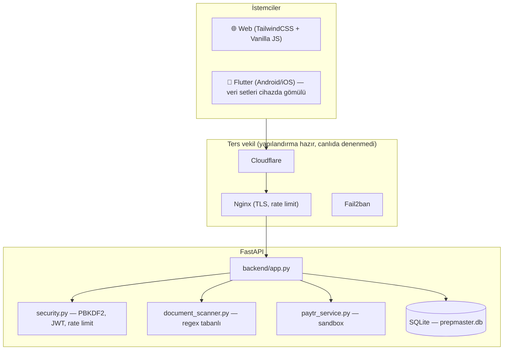

# 🎓 PrepMaster — Üniversite Hazırlık Muafiyet (Proficiency) Platformu Proje Özeti

> **Durum (14.11.2026): Prototip / demo aşaması — canlıya çıkmaya hazır DEĞİL.**
> İçerik havuzu ve arayüzler büyük ölçüde hazır. Ödeme, belge doğrulama, Google girişi
> ve "yapay zeka" değerlendirmesi şu an **simülasyon** olarak çalışıyor. Ayrıca canlıya
> çıkmadan kapatılması gereken **kritik güvenlik açıkları** var (bkz. Bölüm 6).

**PrepMaster**, Türk üniversitelerinin İngilizce hazırlık muafiyet sınavlarına (İTÜ, Boğaziçi BUEPT,
ODTÜ EPE, Bilkent PAE, YTÜ, Hacettepe, Ankara, Gazi, Ege, Koç, Sabancı) ve CEFR (A1–C2)
seviyelerine hazırlanan öğrenciler için Web (FastAPI + Vanilla JS) ve Mobil (Flutter) tabanlı
bir çalışma ve deneme sınavı platformudur.

---

## 1. İş Modeli (hedeflenen)

Öğrenci kendi üniversitesinin içeriğine ücretsiz erişir; başka bir üniversitenin muafiyet
testleri için **50 TL**'lik paket açar.

| Bileşen | Hedef | Bugünkü gerçek durum |
| :--- | :--- | :--- |
| E-posta/şifre kaydı | Tam | ✅ Çalışıyor (PBKDF2 + JWT) |
| Google ile giriş | OAuth 2.0 | ⚠️ **Simülasyon.** Buton `prompt()` ile e-posta soruyor, sahte token gönderiyor; backend token'ı doğrulamıyor. Gerçek Google SDK'sı web'de de mobilde de yok. |
| Şifre sıfırlama / öğrenci OTP | E-posta ile 6 haneli kod | ⚠️ **E-posta gönderilmiyor.** Kod API yanıtında doğrudan istemciye dönüyor. |
| `.edu.tr` doğrulaması | Öğrenci e-postası şartı | ⚠️ Öğrenci numarası 6+ haneliyse e-posta uzantısına bakılmadan geçiyor. |
| Öğrenci belgesi tarama (`document_scanner.py`) | E-Devlet barkodlu belge doğrulama | ⚠️ Metinden regex ile üniversite/numara/barkod **okunuyor**, e-Devlet'te **sorgulanmıyor**. Barkod yoksa uydurma `EDV-…` numarası üretiliyor; elle yazılmış sahte belge kabul edilir. |
| 50 TL ödeme (`paytr_service.py`) | PayTR iFrame + webhook | 🟡 PayTR token/hash/webhook kodu yazılmış, anahtar girilmediği için **sandbox modunda**. Gerçek bir ödeme hiç denenmedi. |
| 3D Secure SMS | Banka onayı | ⚠️ **Simülasyon.** SMS kodunu sunucu kendisi üretip yanıtta geri veriyor. Gerçek PayTR iFrame akışında bu adım bankanın işidir ve kart numarası bizim sunucumuza hiç gelmemelidir — şu an geliyor. |
| E-Arşiv fişi | GİB uyumlu | ⚠️ **Simülasyon.** Sıralı `EARSIV-2026-N` numarası; GİB/entegratör bağlantısı yok. |

---

## 2. İçerik Havuzu (doğrulandı)

| Modül | Kapsam | Not |
| :--- | :--- | :--- |
| **Sorular** | **197 soru**, Türkçe çözümlü (`explanation_tr`) | Dağılım dengesiz: Genel 51, İTÜ 20, Boğaziçi 18, ODTÜ 16, Bilkent 13, YTÜ 7, diğerleri 12'şer. ODTÜ soruları iki farklı kimlikle kayıtlı (`metu` 14 + `odtu` 2) — birleştirilmeli. |
| **Kelime kartları** | **600 kelime** (A1–C2, seviye başına 100) | Eş anlamlı, ipucu, sesli telaffuz var. Aralıklı tekrar (spaced repetition) algoritması koda yansımamış. |
| **Dinleme** | **60 parça** (seviye başına 10) | Yalnızca **16 MP3** var; kalan parçalar tarayıcının seslendirmesiyle (Web Speech Synthesis) okunuyor. Not alma / dinlerken cevaplama modları ve hız kontrolü mevcut. |
| **Konuşma** | **60 görev** | Süre sayaçları ve tarayıcı konuşma tanıma ile transkript var. |
| **Yazma** | **13 rehber** (`writing_guides.json`) | Model makaleler ve kalıp kütüphanesi. |
| **Hata Kasası** | Yanlış soruların tekrarı | Çalışıyor, ancak tablo kullanıcıya bağlı değil (`user_id` yok) — tüm kullanıcılar aynı kasayı paylaşıyor. |
| **Deneme sınavı** | Üniversite formatında tam deneme | `/api/exam/mock/{university_id}` |

**Yazma / konuşma puanlaması:** Özellik "AI" olarak sunuluyor ancak **yapay zeka modeli kullanılmıyor**.
Puanlar kelime sayısı, dakikadaki kelime ve sabit akademik kelime listeleri üzerinden kural tabanlı
hesaplanıyor. Gerçek bir dil modeli bağlanana kadar arayüzde "otomatik ön değerlendirme" denmesi önerilir.

---

## 3. Teknik Mimari



Mobil uygulamanın sunucu adresi kodda sabit (`http://127.0.0.1:8050` / yerel ağ IP'si); canlı alan adı
ve HTTPS henüz bağlanmadı. Veritabanı SQLite; çok kullanıcılı canlı ortam için PostgreSQL'e geçiş düşünülmeli.

---

## 4. Dizin Yapısı

```text
PrepMaster/
├── backend/
│   ├── app.py                 # FastAPI uç noktaları
│   ├── database.py            # SQLite şeması ve veri işlemleri
│   ├── document_scanner.py    # Öğrenci belgesi metin ayrıştırıcı
│   ├── paytr_service.py       # PayTR iFrame token + webhook (sandbox)
│   ├── security.py            # PBKDF2, JWT, rate limit, girdi temizleme
│   ├── generate_audio.py      # Dinleme MP3 üretim betiği
│   └── test_*.py              # Python testleri
├── data/                      # universities, questions, vocabulary, listening, speaking, writing_guides (.json)
├── static/                    # Web arayüzü (index.html, js/, css/, audio/ — 16 MP3)
├── mobile/                    # Flutter uygulaması (lib/, assets/data/, test/)
├── nginx/, docker/fail2ban/   # Ters vekil ve saldırı önleme yapılandırmaları
├── Dockerfile, docker-compose.yml
└── deploy_check.py            # Canlı öncesi yapılandırma kontrol betiği
```

---

## 5. Testler — ne ölçüyor, ne ölçmüyor

- **Python:** 5 dosyada 42 test fonksiyonu (OTP, 3DS, yetkilendirme, güvenlik).
- **Flutter:** 4 dosyada 19 test (veri bütünlüğü, dinleme/yazma, paywall, widget).
- **`deploy_check.py`:** Docker, Nginx, Fail2ban dosyalarının ve veri setlerinin varlığını/biçimini kontrol eder.

Bu testler sistemin **kendi simülasyonu içinde tutarlı** olduğunu gösterir. Gerçek ödeme, gerçek
e-posta gönderimi, gerçek Google doğrulaması ve aşağıdaki güvenlik açıkları test kapsamında değildir;
"testler geçiyor" bilgisi "canlıya hazır" anlamına gelmez.

---

## 6. Canlıya Çıkmadan Önce Kapatılması Gereken Açıklar

### ✅ Kapatılan kritik açıklar (14.11.2026)
Her biri `backend/test_exploit_regressions.py` içinde istismar denemesiyle test ediliyor (21 test; eski kodda 20'si kırılıyordu).

1. **Google girişi** — ID token artık Google'a doğrulatılıyor (`aud`, `iss`, `email_verified`); e-posta istemciden değil token'dan alınıyor. `GOOGLE_CLIENT_ID` tanımlı değilse Google girişi kapalı.
2. **Şifre sıfırlama / OTP / SMS kodları** artık yanıtta dönmüyor. ⚠️ E-posta gönderimi olmadığı için bu akışlar canlıda **kodu kullanıcıya ulaştıramıyor** — e-posta servisi bağlanana kadar fiilen kapalı.
3. **50 TL kilidi** — canlıda üyelik yalnızca PayTR'nin imzalı bildirimiyle açılıyor. Simüle 3DS akışı yalnızca `DEMO_MODE=1`'de çalışıyor; orada da oturum zorunlu ve ödeme oturumu aynı kullanıcıya + aynı üniversiteye ait olmalı. PayTR anahtarı girilmemişken sandbox anahtarıyla sahte bildirim üretilemiyor.
4. **Kullanıcı kimliği** artık yalnızca imzalı oturum token'ından alınıyor; `user_id` parametresi yok sayılıyor. Web (`static/js/auth_fetch.js`) ve mobil (`mobile/lib/services/auth_http.dart`) her isteğe token ekliyor.
5. **Gizli anahtarlar** — `ENVIRONMENT=production`'da `SECRET_KEY` yoksa, 32 karakterden kısaysa ya da depoda yayımlanmış bir değerse uygulama açılmıyor; `DEMO_MODE=1` ile de açılmıyor. Geliştirmede her açılışta rastgele anahtar üretiliyor.

Ayrıca kapatılanlar: `?university_id=all` kilitli soruları da döndürüyordu; kayıtta seçilen üniversite belge doğrulaması olmadan ücretsiz açılıyordu; herkese açık örnek belgelerle "doğrulanmış öğrenci" olunabiliyordu; mobil uygulama çevrimdışıyken ödemeyi ve belge taramasını "başarılı" sayıyordu.

### 🔴 Hâlâ açık
- **Mobil uygulama tüm soruları APK içinde taşıyor** (`mobile/assets/data`). Paywall mobilde istemci tarafında; APK'yı açan biri tüm içeriğe erişir. Kilitli içerik sunucudan indirilmeli.
- **Profil, Hata Kasası, sınav geçmişi, istatistik ve senkronizasyon uç noktaları tek kullanıcılı** (`/api/profile`, `/api/mistakes`, `/api/sync/*` …): kimlik sormuyor ve herkes aynı kaydı okuyup yazıyor. Kullanıcı bazlı tablolara geçiş gerekiyor.
- Dinleme/konuşma içerikleri üniversite kilidine bağlı değil.
- Mevcut veritabanındaki eski kullanıcılarda kayıtta seçtikleri üniversite hâlâ `unlocked_universities` içinde duruyor (yeni kural yalnızca yeni kayıtlara uygulanıyor).

### 🟠 Önemli
6. Kart numarası backend'e gönderiliyor — gerçek PayTR iFrame'e geçince kart bilgisi hiç alınmamalı (PCI-DSS).
7. Öğrenci belgesi doğrulaması sahteciliğe açık; gerçek doğrulama için e-Devlet barkod sorgusu veya elle onay gerekli.
8. Hata Kasası kullanıcıya bağlı değil.

---

## 7. Yol Haritası

1. Bölüm 6'daki "hâlâ açık" maddeleri kapat (kullanıcı bazlı veri, mobil içerik paywall'u).
2. Gerçek Google OAuth (ID token'ı Google'ın anahtarlarıyla doğrula).
3. E-posta gönderimi (SMTP veya bir e-posta servisi) — kodlar yalnızca e-postaya gitsin.
4. PayTR mağaza başvurusu → gerçek anahtarlar → test kartıyla uçtan uca ödeme → webhook ile üyelik açma.
5. E-Arşiv için entegratör seçimi (ya da ilk aşamada fatura işini PayTR/muhasebeciye bırakma).
6. Eksik 44 dinleme MP3'ünü üret, ODTÜ soru kimliklerini birleştir, YTÜ soru sayısını artır.
7. Yazma/konuşma değerlendirmesine gerçek bir dil modeli bağla (ya da "AI" ifadesini kaldır).
8. Canlı sunucu: alan adı, HTTPS, mobil uygulamanın adresini ortam ayarına taşı, SQLite → PostgreSQL.
